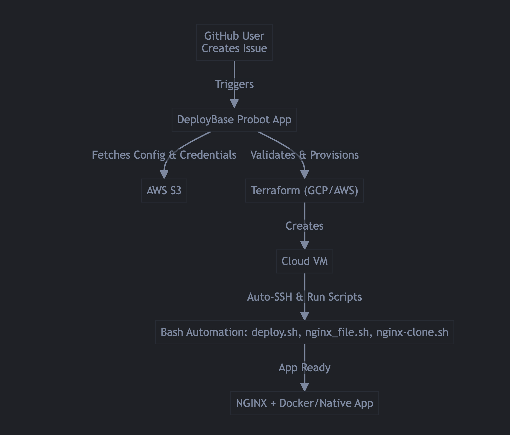

# Deployment Server

## Overview

**Deployment Server** is an enterprise-grade automation platform for seamless virtual machine provisioning and application deployment on Google Cloud Platform (GCP) and Amazon Web Services (AWS). At its core is the **DeployBase** GitHub Probot App, which orchestrates secure, event-driven deployments directly from your GitHub workflow. The platform leverages Terraform for infrastructure-as-code, AWS S3 for secure credential management, and robust bash scripts for automated server setup, NGINX configuration, and application deployment.

---

## Key Features

- **One-Click GitHub Integration**: Authenticate and trigger deployments by simply installing the DeployBase GitHub App.
- **Event-Driven Automation**: DeployBase listens for issue events and repository installations to initiate secure, validated deployments.
- **Cloud-Agnostic Provisioning**: Supports both GCP and AWS, with infrastructure managed via Terraform.
- **Secure Credential Handling**: All sensitive credentials are stored and retrieved from AWS S3, never exposed in code or logs.
- **Custom VM Configuration**: Users can specify custom ports and configurations for their VMs.
- **Automated Server Setup**: Bash scripts handle NGINX, Docker, and application setup with best-practice security.
- **Collaborative & Auditable**: All actions are triggered via GitHub issues and pull requests, ensuring traceability and peer review.

---

## How It Works

### 1. Install DeployBase GitHub App

- Visit the [DeployBase GitHub App page](#) and install it on your repository.
- Grant the app permission to access issues and repository metadata.

### 2. Trigger Deployment via GitHub Issue

- Create a new issue in your repository (e.g., "Deploy my app to GCP").
- DeployBase will listen for the `issues.opened` event and begin the deployment workflow.

### 3. Authentication & Validation

- DeployBase fetches your GitHub identity and validates your access.
- It retrieves your GCP credentials (previously stored securely in AWS S3) and project configuration.

### 4. Infrastructure Provisioning

- Using Terraform, DeployBase validates your GCP account and provisions a VM with your specified configuration and ports.
- All Terraform state and secrets are handled securely.

### 5. Automated Server & Application Setup

- DeployBase securely SSHs into the new VM and executes a series of hardened bash scripts:
  - **`deploy.sh`**: End-to-end automation for installing NGINX, Docker, Docker Compose, and cloning your repository. Handles both public and private repos, and ensures all dependencies are installed with proper permissions.
  - **`nginx_file.sh`**: Dynamically generates and applies secure NGINX configurations based on your app's frontend/backend routes and ports. Enforces best practices (e.g., denying access to hidden files).
  - **`nginx-clone.sh`**: Installs NGINX, clones your repository, and sets permissions to ensure NGINX can serve your app securely, even from protected directories.

- All scripts are executed with strict error checking and privilege management to minimize risk.

### 6. Continuous Collaboration

- All deployment actions are logged and auditable via GitHub issues and pull requests.
- Team members can review, approve, or trigger redeployments as needed.

---

## Architecture



---

## Technology Stack

- **Languages**: JavaScript (Node.js), Bash
- **Cloud Providers**: GCP, AWS
- **Infrastructure**: Terraform
- **Containerization**: Docker, Docker Compose
- **Web Server**: NGINX
- **Credential Storage**: AWS S3
- **CI/CD & Automation**: DeployBase (Github Probot App)

---

## Getting Started

### Prerequisites

- Node.js (>= 18)
- Docker & Docker Compose
- Terraform (>= 1.0)
- AWS & GCP accounts with appropriate permissions
- GitHub App credentials (for DeployBase


### 1. Clone the Repository

```sh
git clone <your-repo-url>
cd Deployment-Server
```

### 2. Configure Environment Variables

Create a `.env` file in `first-app/` with:

```
AWS_ACCESS_KEY_ID=your-aws-access-key
AWS_SECRET_ACCESS_KEY=your-aws-secret-key
AWS_REGION=your-aws-region
S3_BUCKET_NAME=your-s3-bucket
API_URL=https://your-api-server
```

### 3. Install Dependencies & Run DeployBase

```sh
cd first-app
npm install
npm start
```

### 4. Docker Deployment (Optional)

```sh
docker build -t deployment-server ./first-app
docker run -e APP_ID=<app-id> -e PRIVATE_KEY=<pem-value> deployment-server
```

### 5. Infrastructure Provisioning with Terraform

```sh
cd gcp-auth
terraform init
terraform apply -auto-approve \
  -var="credentials=$(cat <gcp-credentials-json>)" \
  -var="region=<gcp-region>" \
  -var="project_id=<gcp-project-id>"
```

### 6. Automated Server Setup

Use the provided bash scripts for secure, automated setup:

- **`deploy.sh`**: Installs NGINX, Docker, Docker Compose, and clones your repo. Handles both public/private repos and sets up the environment for your app.
- **`nginx_file.sh`**: Generates and applies NGINX configs for custom frontend/backend routes and ports, with security best practices.
- **`nginx-clone.sh`**: Installs NGINX, clones your repo, and configures permissions for secure serving.

---

## Security Best Practices

- **Credential Storage**: All sensitive keys are stored in AWS S3 and never hardcoded.
- **SSH & NGINX**: Automated scripts enforce secure permissions and configurations.
- **API Authentication**: All API endpoints require authentication and follow least-privilege principles.
- **Code Reviews**: All changes are peer-reviewed via GitHub PRs.
- **Script Hardening**: Bash scripts check for privilege escalation, validate inputs, and enforce secure defaults.

---

## API & Configuration

- **Project Settings**: Managed via RESTful APIs (see `first-app/index.js` for endpoints).
- **GitHub App Events**: Handles `installation_repositories` and `issues.opened` for deployment triggers.
- **Terraform Variables**: Credentials, region, and project ID are passed securely at runtime.

---

## Contribution Guidelines

We welcome contributions! Please read our [CONTRIBUTING.md](first-app/CONTRIBUTING.md) and [CODE_OF_CONDUCT.md](first-app/CODE_OF_CONDUCT.md) before submitting pull requests.

---

## License

This project is licensed under the [ISC License](first-app/LICENSE).

---

## Acknowledgements

- [Probot](https://probot.github.io/)
- [Terraform](https://www.terraform.io/)
- [AWS S3](https://aws.amazon.com/s3/)
- [NGINX](https://nginx.org/)
- [Docker](https://www.docker.com/)
